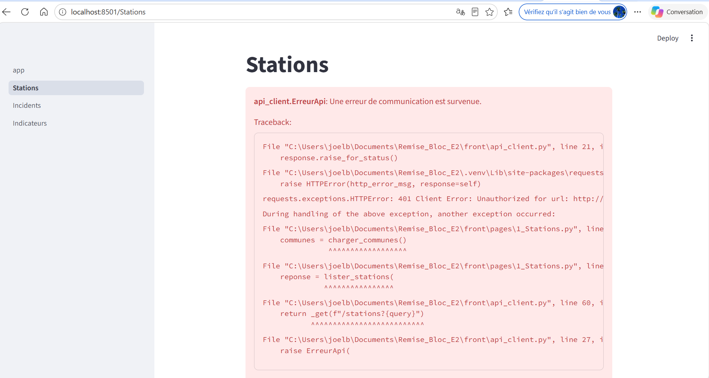

# ANO-001 — Le front n'envoie pas le jeton JWT aux routes protégées

Cas de test : REC-10          
Statut : corrigée

Sévérité : S2       
Priorité : P1 

Constatée le 20/11/2026 par <Corinne_JANKOWSKI>

Échelle de sévérité : 
S1 bloquante (service indisponible, donnée fausse, faille d'accès), 
S2 majeure (fonction dégradée mais contournable), 
S3 mineure (gêne de confort, donnée intacte). 
La priorité (P1 à P3) est l'ordre de traitement décidé ; elle ne se confond pas avec la sévérité.

## Environnement
Version :

base rechargée : non

compte utilisé : direction01

écran concerné : Stations

## Reproduction
1. Démarrer l'API avec les routes sécurisées par JWT
2. Démarrer l'application Stramlit
3. Ouvrir la page Stations
4. Observer le résultat affiché

## Attendu / obtenu
Attendu : l'écran affiche les indicateurs
Obtenu  : l'écran affiche une erreur de communication. L'API renvoie HTTP 401 Unauthorized car aucun jeton JWT n'est transmis dans les requêtes HTP du front

## Preuve

Traceback (most recent call last):
  File "C:\Users\joelb\Documents\Remise_Bloc_E2\front\api_client.py", line 21, in _get
    response.raise_for_status()
  File "C:\Users\joelb\Documents\Remise_Bloc_E2\.venv\Lib\site-packages\requests\models.py", line 1167, in raise_for_status
    raise HTTPError(http_error_msg, response=self)
requests.exceptions.HTTPError: 401 Client Error: Unauthorized for url: http://localhost:8000/stations?page=1&taille_page=100

## Correction
Commit : <identifiant court>  Test de non-régression : <chemin::test>
Rejoué le 20/11/2026 : OK 

