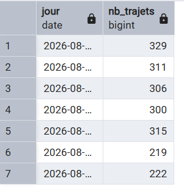

# Résultats de recette

À compléter : relevé d'exécution des cas REC-01 à REC-10, synthèse chiffrée, axes
d'amélioration, procès-verbal.


## Conditions d'exécution

- Base `veloville` créée avec `sql/schema.sql`, comptes chargés avec
  `sql/comptes.sql`, import exécuté une fois avec `scripts/importer.py`.
- API démarrée : `uvicorn api.main:app --port 8000`.
- Front démarré : `streamlit run front/app.py`.
- Les appels HTTP sont faits avec `curl`, `httpx` ou le client interactif de
  FastAPI (`/docs`) ; la commande ou la capture est conservée comme preuve.
- Statuts possibles : **OK**, **KO**, **NT** (non testé, avec motif).
- Dans les étapes, `$JETON_EXPLOITANT` et `$JETON_DIRECTION` désignent les
  jetons obtenus par `POST /auth/login` avec les comptes fournis.

## Cas de test

### REC-01 — Import idempotent

| | |
|---|---|
| Objectif | Vérifier qu'une seconde exécution de l'import ne modifie pas la base |
| Prérequis | Base créée, comptes chargés, aucun import encore exécuté |
| Étapes | 1. Exécuter `python scripts/importer.py`. 2. Relever `SELECT count(*) FROM station`, `FROM trajet`, `FROM incident`. 3. Exécuter de nouveau `python scripts/importer.py`. 4. Relever les trois comptages. |
| Résultat attendu | Les deux exécutions se terminent sans erreur ; les trois comptages sont identiques entre les étapes 2 et 4 ; `count(*) FROM station` vaut 120. |
| Résultat obtenu | après 2 exécution du script, les résultats de comptage sont identiques => SELECT count(*) FROM station : 120 / FROM trajet : 2002 / FROM incident : 177| 
| Statut | OK |

### REC-02 — Rejets journalisés et cohérence des volumes

| | |
|---|---|
| Objectif | Vérifier que chaque ligne écartée est tracée avec son motif et que rien n'est perdu silencieusement |
| Prérequis | REC-01 exécuté |
| Étapes | 1. Ouvrir le journal des rejets et avertissements produit par l'import. 2. Pour chacun des trois fichiers, compter : lignes du CSV (hors en-tête), lignes importées (`count(*)`), rejets journalisés, doublons écartés journalisés. 3. Vérifier qu'une ligne du journal comporte au moins : fichier source, identifiant, colonne, valeur, motif, décision. 4. Exécuter : `SELECT count(*) FROM trajet t LEFT JOIN station s ON s.station_id = t.station_arrivee WHERE t.station_arrivee IS NOT NULL AND s.station_id IS NULL;` |
| Résultat attendu | Pour chaque fichier : importées + rejetées + doublons écartés = lignes du CSV. Chaque ligne du journal porte les six informations. La requête de l'étape 4 renvoie 0. |
| Résultat obtenu | exemple : fichier,ligne,identifiant,colonne,valeur,motif,decision,categorie
trajets.csv,31,T480030,station_arrivee,S999,station inexistante dans stations.csv,rejet,
trajets.csv,35,T480034,station_arrivee,S999,station inexistante dans stations.csv,rejet,
trajets.csv,75,T480073,trajet_id,T480073,identifiant dupliqué,rejet,doublon
trajets.csv,81,T480078,trajet_id,T480078,identifiant dupliqué,rejet,doublon 
La requete renvoie bien 0|
| Statut | OK |

### REC-03 — Connexion acceptée

| | |
|---|---|
| Objectif | Obtenir un jeton avec un compte valide |
| Prérequis | API démarrée, comptes chargés |
| Étapes | 1. `POST /auth/login` avec `{"username": "exploitant01", "password": "Formation2026!"}`. 2. Lire le code HTTP et le corps. 3. Répéter avec `direction01`. |
| Résultat attendu | 200 ; corps contenant `access_token` non vide, `token_type` = `bearer`, `role` = `exploitant` (puis `direction`). |
| Résultat obtenu | 200 ; "access_token": "eyJhbGciOiJIUzI1NiIsI..........","token_type": "bearer", "role": "exploitant"
200 ; "access_token": "eyJhbGciOiJIUzI1NiIsInR5cCI6IkpXVCJ9........","token_type": "bearer", "role": "direction"|
| Statut | OK |

### REC-04 — Connexion refusée

| | |
|---|---|
| Objectif | Refuser un mot de passe incorrect sans révéler d'information |
| Prérequis | API démarrée |
| Étapes | 1. `POST /auth/login` avec `{"username": "exploitant01", "password": "mauvais"}`. 2. `POST /auth/login` avec `{"username": "inconnu", "password": "Formation2026!"}`. |
| Résultat attendu | 401 dans les deux cas, corps `{"detail": "Identifiants invalides"}` ; le message est identique pour un identifiant inconnu et pour un mot de passe erroné. |
| Résultat obtenu | 401 ; "detail": "Identifiants invalides"
| Statut | OK |

### REC-05 — Route protégée sans jeton

| | |
|---|---|
| Objectif | Vérifier que les ressources exigent un jeton |
| Prérequis | API démarrée |
| Étapes | 1. `GET /stations` sans en-tête `Authorization`. 2. `GET /stations` avec `Authorization: Bearer jeton.invalide.xyz`. 3. `GET /sante` sans en-tête. |
| Résultat attendu | Étapes 1 et 2 : 401. Étape 3 : 200 `{"statut": "ok"}`. |
| Résultat obtenu | 401 ; "detail": "Authentification requise" puis  401 ; "detail": "Token invalide" puis 200 ; "statut": "ok"|
| Statut | OK |

### REC-06 — Rôle direction refusé sur la modification d'un incident

| | |
|---|---|
| Objectif | Vérifier la séparation des droits entre les deux rôles |
| Prérequis | Jetons des deux comptes ; un incident au statut `ouvert`, noté `<id>` |
| Étapes | 1. `PUT /incidents/<id>/statut` avec `{"statut": "en_cours"}` et `$JETON_DIRECTION`. 2. Relever le statut de l'incident en base. 3. Même appel avec `$JETON_EXPLOITANT`. 4. Relever le statut en base. 5. `PUT /incidents/<id>/statut` avec `{"statut": "en_cours"}` et `$JETON_EXPLOITANT` (seconde fois). |
| Résultat attendu | Étape 1 : 403 `{"detail": "Acces reserve au role exploitant"}` ; étape 2 : statut inchangé `ouvert`. Étape 3 : 200, incident retourné avec `statut` = `en_cours` ; étape 4 : `en_cours` en base. Étape 5 : 422 `{"detail": "Transition de statut non autorisee"}`. |
| Résultat obtenu | incident "I2026-0065" avec 403, "detail": "Role non autorise" puis 200 ; "statut": "en_cours", access-control-allow-credentials: true 
 content-length: 229 
 content-type: application/json 
 date: Fri,20 Nov 2026 15:59:07 GMT 
 server: uvicorn 
 vary: Origin 
  puis 422 ; "detail": "Transition de statut non autorisee" |
| Statut | KO sur l'intitulé "role non autorisé" au lieu de "Acces reserve au role exploitant" |

### REC-07 — Pagination

| | |
|---|---|
| Objectif | Vérifier l'enveloppe paginée, ses bornes et sa cohérence |
| Prérequis | `$JETON_DIRECTION` ; import exécuté |
| Étapes | 1. `GET /stations?taille_page=50&page=1`. 2. `GET /stations?taille_page=50&page=3`. 3. `GET /stations?commune=Lille&taille_page=100`. 4. `GET /stations?page=0`. 5. `GET /stations?taille_page=101`. |
| Résultat attendu | Étape 1 : 200, `total` = 120, `page` = 1, `taille_page` = 50, 50 résultats, premier `station_id` = `S001`. Étape 2 : 200, 20 résultats. Étape 3 : 200, `total` = 46, tous les résultats ont `commune` = `Lille`. Étapes 4 et 5 : 422. |
| Résultat obtenu | à remplir |
| Statut | à remplir |

### REC-08 — Station introuvable

| | |
|---|---|
| Objectif | Vérifier le code et le message pour un identifiant inexistant |
| Prérequis | `$JETON_DIRECTION` |
| Étapes | 1. `GET /stations/S001`. 2. `GET /stations/S999`. |
| Résultat attendu | Étape 1 : 200, `station_id` = `S001`, `nom` = `Lille - Gare`. Étape 2 : 404 `{"detail": "Station introuvable"}`. |
| Résultat obtenu | 200 ; `station_id` = `S001`, `nom` = `Lille - Gare`  puis 404, "detail"; "Station introuvable"  |
| Statut | OK |

### REC-09 — Cohérence de l'indicateur « activité par jour » avec la base

| | |
|---|---|
| Objectif | Vérifier qu'un indicateur restitue exactement ce que contient la base |
| Prérequis | `$JETON_DIRECTION` ; import exécuté |
| Étapes | 1. `GET /indicateurs/activite-par-jour?date_debut=2026-08-24&date_fin=2026-08-30`. 2. Exécuter en SQL : `SELECT depart_horodatage::date AS jour, count(*) AS nb_trajets FROM trajet WHERE depart_horodatage::date BETWEEN '2026-08-24' AND '2026-08-30' GROUP BY jour ORDER BY jour;`. 3. Comparer ligne à ligne. 4. Vérifier que la somme des `nb_trajets` de la réponse est égale au `total` renvoyé par `GET /trajets?date_debut=2026-08-24&date_fin=2026-08-30`. |
| Résultat attendu | Les lignes de la réponse et de la requête sont identiques (mêmes jours, mêmes comptages, ordre croissant) ; l'égalité de l'étape 4 est vérifiée. |
| Résultat obtenu |  et somme des nb_trajets (= 2002) est bien égale au total renvoyé le GET borné |
| Statut | OK |

### REC-10 — Front : état vide et état d'erreur

| | |
|---|---|
| Objectif | Vérifier que le front gère l'absence de résultat et la panne de l'API sans trace technique |
| Prérequis | API et front démarrés ; connexion avec `direction01` dans le front |
| Étapes | 1. Écran Incidents : filtrer sur un statut qui ne renvoie aucun résultat (par exemple après avoir, au préalable, vérifié qu'un statut est absent ; sinon utiliser l'écran Stations avec une page au-delà de la dernière). 2. Arrêter l'API. 3. Recharger l'écran Stations. 4. Recharger l'écran Indicateurs. 5. Redémarrer l'API et recharger l'écran Stations. |
| Résultat attendu | Étape 1 : message « Aucun résultat pour ces critères. » (ou équivalent en français), pas d'erreur. Étapes 3 et 4 : un message d'erreur en français indiquant que l'API est injoignable ; aucune trace Python ni code source à l'écran. Étape 5 : le tableau s'affiche de nouveau. |
| Résultat obtenu | à remplir |
| Statut | à remplir |

## Relevé d'exécution (à recopier dans `resultats-recette.md`)

| Cas | Date et heure | Version testée (commit ou tag) | Statut | Preuve | Anomalie |
|---|---|---|---|---|---|
| REC-01 | | | | | |
| REC-02 | | | | | |
| REC-03 | | | | | |
| REC-04 | | | | | |
| REC-05 | | | | | |
| REC-06 | | | | | |
| REC-07 | | | | | |
| REC-08 | | | | | |
| REC-09 | | | | | |
| REC-10 | | | | | |

Synthèse : N cas exécutés sur 10 ; N OK, N KO, N NT ; N anomalies ouvertes,
N corrigées.

## Modèle de fiche d'anomalie (`docs/recette/anomalies/ANO-0NN.md`)

```markdown
# ANO-0NN — Le symptôme en une phrase factuelle

Cas de test : REC-0N          Statut : ouverte | corrigée | fermée
Sévérité : S1 | S2 | S3       Priorité : P1 | P2 | P3
Constatée le JJ/MM/AAAA par <nom>

## Environnement
Version (commit ou tag), base rechargée oui/non, compte utilisé, route ou
écran concerné.

## Reproduction
1. <état de départ : base rechargée, données>
2. <action>
3. <lecture du résultat>

## Attendu / obtenu
Attendu : <valeur ou état exact>
Obtenu  : <valeur ou état exact, sans interprétation>

## Preuve
<commande et réponse, ou chemin de la capture>

## Correction
Commit : <identifiant court>  Test de non-régression : <chemin::test>
Rejoué le JJ/MM/AAAA : OK | KO
```

Échelle de sévérité : **S1 bloquante** (service indisponible, donnée fausse,
faille d'accès), **S2 majeure** (fonction dégradée mais contournable),
**S3 mineure** (gêne de confort, donnée intacte). La priorité (P1 à P3) est
l'ordre de traitement décidé ; elle ne se confond pas avec la sévérité.

## Modèle de procès-verbal de recette

```markdown
# Procès-verbal de recette — VéloVille V1 <version>

## 1. Identification
Application, version testée, date de la campagne, environnement (postes,
versions de Python et PostgreSQL), participants et rôles.

## 2. Périmètre recetté
Ce qui a été testé (REC-01 à REC-10). Ce qui ne l'a pas été, et pourquoi.

## 3. Résultats de la campagne
N cas prévus, N exécutés : N OK, N KO, N NT.
Anomalies : N ouvertes, N corrigées et rejouées OK.

## 4. Réserves bloquantes
Par anomalie : numéro, symptôme, correctif exigé. Ou : néant.

## 5. Réserves non bloquantes
Par anomalie : numéro, symptôme, responsable, échéance datée.

## 6. Décision
Recette PRONONCÉE | PRONONCÉE AVEC RÉSERVES | REFUSÉE
Motivation en une ou deux phrases.

## 7. Signatures
Pour le commanditaire — pour le développeur, date.
```
